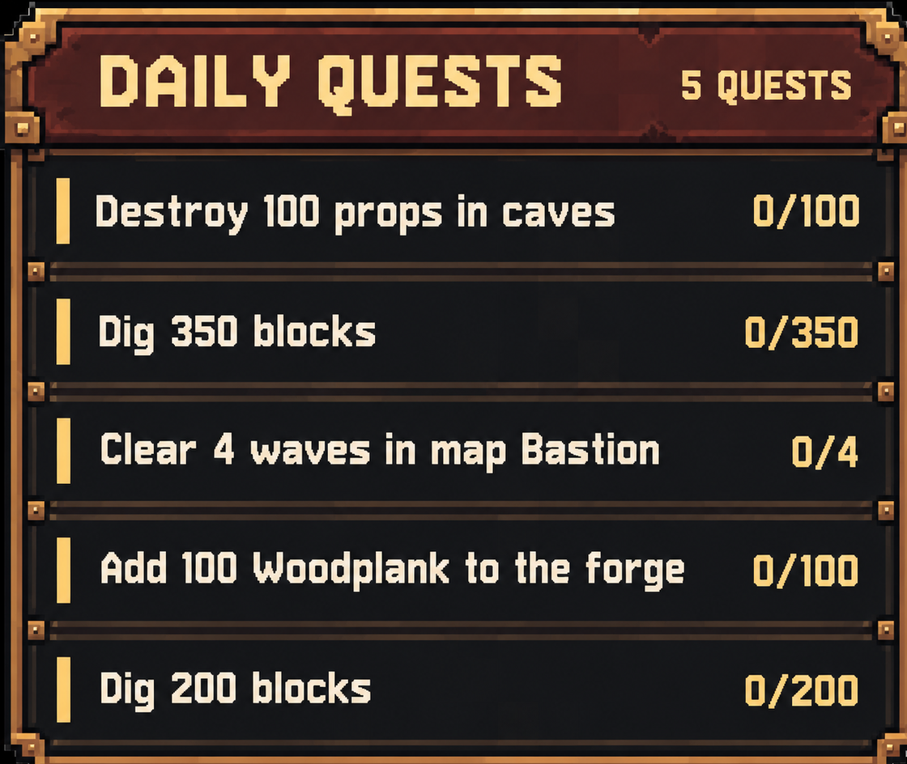

# Stonewards Daily Quest Tracker

**Your daily objectives, right where you need them.** A lightweight, client-side quest tracker that keeps the current Stonewards daily missions and their live progress visible during a run.

<p align="center">
  
</p>

> Illustrated UI preview. The in-game HUD is more compact and uses live quest data.

[](https://thunderstore.io/c/stonewards/)
[](https://thunderstore.io/c/stonewards/p/BepInEx/BepInExPack/)
[](https://thunderstore.io/c/stonewards/)


## Why use it?

- **Live daily progress** — quest descriptions and `current / target` counters come directly from Stonewards, not from guessed gameplay events.
- **Unobtrusive HUD** — compact text-only panel with the game's dark, burgundy-and-gold aesthetic.
- **Completed quest handling** — hide completed objectives, or show them at the bottom with a green checkmark.
- **Follows your coins** — positions itself below the currency display when it can locate it; configurable fallback placement.
- **Resolution-aware** — adapts proportionally from 1080p to 1440p, 4K and ultrawide monitors.
- **Client-side only** — no server installation and no gameplay or save modification.

## In-game behavior

| Situation | What you see |
| --- | --- |
| A daily objective gains progress | The counter updates automatically |
| An objective completes (`Hide` mode) | The row disappears; the panel gets shorter |
| An objective completes (`Mark` mode) | A green check and completed row below unfinished quests |
| All daily objectives complete | A small `ALL QUESTS COMPLETED` message in `Hide` mode |
| Missions, inventory or other supported game menus open | The HUD gets out of the way |

**Hotkeys:** `F6` toggles the panel. `F9` exports a diagnostic report only when troubleshooting.

## Installation

### Via Thunderstore / r2modman

Once published, install **DailyQuestTracker** from the [Stonewards community](https://thunderstore.io/c/stonewards/) with r2modman or another Thunderstore-compatible mod manager. BepInEx is installed automatically as a dependency. Launch the game through the mod manager.

Only players who want to see the overlay need this mod.

### Build from source

Requirements: Stonewards installed locally, .NET SDK and a BepInEx 5 profile.

```powershell
git clone https://github.com/thereisnouser/stonewards-daily-quest-tracker.git
cd stonewards-daily-quest-tracker

powershell -ExecutionPolicy Bypass -File .\build-and-install.ps1 `
  -GameDir "F:\Steam\steamapps\common\Stonewards" `
  -ProfileDir "C:\Users\user\AppData\Roaming\r2modmanPlus-local\Stonewards\profiles\stonewards-daily-quest-tracker"
```

Close Stonewards before rebuilding: Windows cannot overwrite a DLL still loaded by the game.

## Configuration

Edit `BepInEx/config/community.stonewards.dailyquesttracker.cfg` in your selected profile after the first launch.

| Setting | Default | Purpose |
| --- | --- | --- |
| `General.CompletedQuestMode` | `Hide` | `Hide` completed objectives or `Mark` them with a check |
| `Appearance.AnchorToCurrencyHud` | `true` | Place below the in-game currency panel if detected |
| `Appearance.CurrencyGap` | `10` | Spacing below the currency panel in pixels |
| `Appearance.Anchor` | `TopRight` | Screen corner when using manual positioning |
| `Appearance.HorizontalOffset` | `18` | Manual horizontal edge inset, in pixels |
| `Appearance.VerticalOffset` | `240` | Manual vertical edge inset, in pixels |
| `Appearance.AutoScaleToResolution` | `true` | Scale with screen resolution |
| `Appearance.Scale` | `1.0` | Base HUD size |
| `Appearance.ReadabilityScale` | `1.12` | Additional text/panel enlargement |
| `General.RefreshSeconds` | `1.25` | Interval for reading quest progress |

Other settings include `General.Enabled`, `General.ShowMissingQuestData` and configurable hotkeys.

The currency anchor uses a bounded UI lookup; when it cannot identify the coin display, normal manual offsets remain available.

## Feedback and development

Found an issue or have an idea? [Open a GitHub issue](https://github.com/thereisnouser/stonewards-daily-quest-tracker/issues).

The tracker reads the game's selected daily quests from `QuestManager.CurrentDailyQuests` and their live values from `QuestManager.runtimeMissions`. It does not write quest data or send network messages. Tested on Stonewards **0.2.3**; future game updates may require adjustments.

Developers can run `build-thunderstore.ps1` to generate a Thunderstore ZIP from the locally built DLL and packaged art assets. See [Release packaging](thunderstore/README.md).
